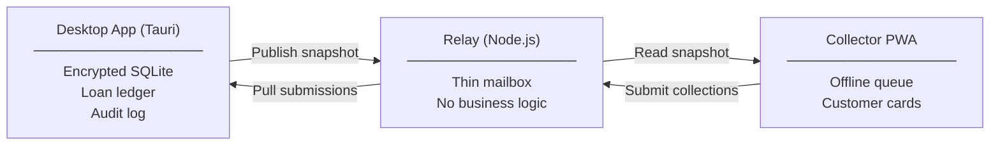

# Privolent

A self-hosted daily loan collection system built for small lending operations. The owner runs an encrypted desktop app on their machine; field collectors use a lightweight mobile web app on their phones.

There is no shared cloud database. The relay is just a mailbox — it passes collection records from collectors to the desktop and serves a read-only snapshot back. All real data lives in an encrypted SQLite database on the owner's computer.

## How it works



The desktop app is the single source of truth. The relay holds submissions until the owner pulls them, then deletes them after acknowledgement. The PWA works offline and syncs automatically when connectivity returns.

## Repository layout

```
src/                   React frontend for the desktop app
src-tauri/             Rust backend (Tauri 2)
  src/
    engine.rs          Pure loan calculation engine
    crypto.rs          Argon2id key derivation
    db.rs              SQLCipher connection management
    commands.rs        Tauri IPC command handlers
    relay_client.rs    Sync client and snapshot publisher
    backup.rs          Encrypted backup and CSV import
relay/                 Thin HTTP relay server (Node.js)
collector-pwa/         Offline-capable mobile PWA
docs/                  Architecture decisions and product spec
```

## Prerequisites

- Node.js ≥ 18 and [pnpm](https://pnpm.io)
- Rust ≥ 1.77 (via [rustup](https://rustup.rs))
- On Linux: `build-essential`, `libwebkit2gtk-4.1-dev`, `libayatana-appindicator3-dev`

## Getting started

```bash
git clone https://github.com/knownasnaffy/privolent
cd privolent
pnpm install
```

Run the relay server (collectors need this to submit payments):

```bash
pnpm relay
# http://localhost:3001
# Collector PWA served at http://localhost:3001/collector/
```

Run the desktop app in development mode:

```bash
pnpm tauri dev
```

## Running tests

```bash
pnpm test                                           # all suites
cargo test --manifest-path src-tauri/Cargo.toml    # Rust only
pnpm test:relay                                     # relay only
pnpm test:pwa                                       # PWA only
```

## Building for production

```bash
pnpm build
pnpm tauri build
```

This produces a signed installer in `src-tauri/target/release/bundle/`.

## Backups and data export

Everything is in **Settings** inside the desktop app:

- **Encrypted Backup** — exports a `.encbak` file (SQLCipher database + Argon2id salt). Unreadable without the owner's passphrase.
- **Decrypted JSON Export** — human-readable dump of all customers, loans, and payments for external bookkeeping.
- **Legacy CSV Import** — seeds the database from existing loan records.

For more on the architecture and domain rules, see [`docs/`](docs/).

## License

This project is licensed under the [GNU General Public License v3.0](LICENSE). See the LICENSE file for details.
